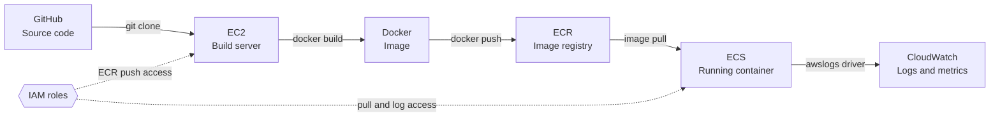

<div align="center">

# Node.js on AWS: Containerized Deployment Pipeline

**Deploy a Node.js application to AWS using GitHub, EC2, Docker, ECR, IAM, ECS, and CloudWatch.**


</div>

---

## Table of contents

- [Overview](#overview)
- [Architecture](#architecture)
- [Tech stack](#tech-stack)
- [Prerequisites](#prerequisites)
- [Project structure](#project-structure)
- [Run locally](#run-locally)
- [Deploy to AWS](#deploy-to-aws)
  - [1. Launch the EC2 build server](#1-launch-the-ec2-build-server)
  - [2. Configure IAM roles](#2-configure-iam-roles)
  - [3. Build the Docker image](#3-build-the-docker-image)
  - [4. Push the image to ECR](#4-push-the-image-to-ecr)
  - [5. Run the container on ECS](#5-run-the-container-on-ecs)
  - [6. Monitor with CloudWatch](#6-monitor-with-cloudwatch)
- [Environment variables](#environment-variables)
- [Troubleshooting](#troubleshooting)
- [Security best practices](#security-best-practices)
- [Roadmap](#roadmap)
- [Contributing](#contributing)
- [License](#license)
- [Author](#author)

---

## Overview

This project demonstrates a complete, production-style path from source code to a running container on AWS. A Node.js application is stored on GitHub, built into a Docker image on an EC2 instance, stored in Amazon ECR, run by Amazon ECS, and monitored through Amazon CloudWatch. IAM roles secure every step, so no long-lived access keys are stored on servers.

**What you will learn from this repository**

- Containerizing a Node.js app with Docker
- Building and pushing images to a private registry (ECR)
- Securing AWS services with IAM roles and least-privilege policies
- Running containers with ECS (clusters, task definitions, services)
- Centralizing logs and metrics with CloudWatch

---

## Architecture



| Stage | Service | Responsibility |
|---|---|---|
| 1 | GitHub | Stores the application source code and Dockerfile |
| 2 | EC2 | Build server: clones the repo, builds the Docker image |
| 3 | Docker | Packages the app and its dependencies into an image |
| 4 | ECR | Private registry that stores versioned images |
| 5 | IAM | Grants EC2 permission to push and ECS permission to pull and log |
| 6 | ECS | Runs and supervises the container as a service |
| 7 | CloudWatch | Collects container logs, metrics, and alarms |

---

## Tech stack

| Layer | Technology |
|---|---|
| Application | Node.js |
| Containerization | Docker |
| Source control | Git and GitHub |
| Compute (build) | Amazon EC2 |
| Image registry | Amazon ECR |
| Orchestration | Amazon ECS |
| Access control | AWS IAM |
| Observability | Amazon CloudWatch |

---

## Prerequisites

Before you begin, make sure you have:

- An AWS account with permission to create EC2, ECR, ECS, IAM, and CloudWatch resources
- [AWS CLI](https://docs.aws.amazon.com/cli/latest/userguide/getting-started-install.html) v2 installed and configured (`aws configure`)
- [Docker](https://docs.docker.com/get-docker/) installed locally
- [Node.js](https://nodejs.org/) 18 or later and npm
- Git
- An EC2 key pair (`.pem` file) for SSH access

---

## Project structure

```text
.
├── src/                  # Application source (adjust to your layout)
├── index.js              # Application entry point
├── package.json          # Dependencies and scripts
├── Dockerfile            # Image build instructions
├── .dockerignore         # Files excluded from the image
├── .gitignore
└── README.md
```

> Update this tree to match your repository.

---

## Run locally

```bash
# 1. Clone the repository
git clone https://github.com/<your-username>/<your-repo>.git
cd <your-repo>

# 2. Install dependencies
npm install

# 3. Start the app
npm start
```

The app listens on port `3000` by default: [http://localhost:3000](http://localhost:3000).

**Run with Docker locally**

```bash
docker build -t node-app .
docker run -d -p 3000:3000 --name node-app node-app
docker logs -f node-app
```

---

## Deploy to AWS

Set these shell variables once to keep the commands below consistent:

```bash
export AWS_REGION=<your-region>          # e.g. us-east-1
export ACCOUNT_ID=<your-aws-account-id>
export REPO_NAME=node-app
export ECR_URI=$ACCOUNT_ID.dkr.ecr.$AWS_REGION.amazonaws.com/$REPO_NAME
```

### 1. Launch the EC2 build server

1. Open **EC2 → Launch instance**.
2. Choose **Amazon Linux 2023** (or Amazon Linux 2) and a `t2.micro` / `t3.micro` instance type.
3. Select your key pair.
4. Create a **Security Group** that allows:
   - SSH (22) from **your IP only**
   - Your application port (for example 3000) if you want direct access
5. Attach the **IAM role** from the next section (or attach it after launch under *Actions → Security → Modify IAM role*).
6. Connect and install the tools:

```bash
ssh -i my-key.pem ec2-user@<public-ip>

sudo yum update -y
sudo yum install -y docker git
sudo systemctl enable --now docker
sudo usermod -aG docker ec2-user
exit   # log back in so the docker group applies
```

### 2. Configure IAM roles

Use roles instead of access keys. Two roles are needed:

| Role | Attached to | Managed policy |
|---|---|---|
| EC2 instance role | The EC2 build server | `AmazonEC2ContainerRegistryPowerUser` |
| ECS task execution role | ECS tasks | `AmazonECSTaskExecutionRolePolicy` |

Trust policy for the ECS task execution role:

```json
{
  "Version": "2012-10-17",
  "Statement": [
    {
      "Effect": "Allow",
      "Principal": { "Service": "ecs-tasks.amazonaws.com" },
      "Action": "sts:AssumeRole"
    }
  ]
}
```

### 3. Build the Docker image

Create a `Dockerfile` in the project root:

```dockerfile
FROM node:18-alpine
WORKDIR /app
COPY package*.json ./
RUN npm install --omit=dev
COPY . .
EXPOSE 3000
CMD ["node", "index.js"]
```

Create a `.dockerignore`:

```text
node_modules
npm-debug.log
.env
.git
```

On the EC2 instance:

```bash
git clone https://github.com/<your-username>/<your-repo>.git
cd <your-repo>
docker build -t $REPO_NAME .
```

### 4. Push the image to ECR

```bash
# Create the repository (first time only)
aws ecr create-repository --repository-name $REPO_NAME --region $AWS_REGION

# Authenticate Docker to ECR
aws ecr get-login-password --region $AWS_REGION | \
  docker login --username AWS --password-stdin $ACCOUNT_ID.dkr.ecr.$AWS_REGION.amazonaws.com

# Tag and push
docker tag $REPO_NAME:latest $ECR_URI:latest
docker push $ECR_URI:latest
```

### 5. Run the container on ECS

1. **Create a cluster** (ECS → Clusters → Create cluster). Choose **AWS Fargate** for a serverless setup.
2. **Create a log group** for container logs:

```bash
aws logs create-log-group --log-group-name /ecs/$REPO_NAME --region $AWS_REGION
```

3. **Register a task definition.** Example for Fargate:

```json
{
  "family": "node-app",
  "networkMode": "awsvpc",
  "requiresCompatibilities": ["FARGATE"],
  "cpu": "256",
  "memory": "512",
  "executionRoleArn": "arn:aws:iam::<account-id>:role/ecsTaskExecutionRole",
  "containerDefinitions": [
    {
      "name": "node-app",
      "image": "<account-id>.dkr.ecr.<region>.amazonaws.com/node-app:latest",
      "essential": true,
      "portMappings": [{ "containerPort": 3000, "protocol": "tcp" }],
      "logConfiguration": {
        "logDriver": "awslogs",
        "options": {
          "awslogs-group": "/ecs/node-app",
          "awslogs-region": "<region>",
          "awslogs-stream-prefix": "ecs"
        }
      }
    }
  ]
}
```

```bash
aws ecs register-task-definition --cli-input-json file://task-definition.json
```

4. **Create a service** (ECS → Cluster → Services → Create). Select the task definition, set the desired task count, choose your VPC and subnets, and attach a security group that allows inbound traffic on port 3000.
5. Wait until the task status shows **RUNNING**, then open the task's public IP on port 3000.

### 6. Monitor with CloudWatch

- **Logs:** CloudWatch → Log groups → `/ecs/node-app`
- **Metrics:** CPU and memory utilization for the ECS service
- **Alarms:** create an alarm (for example, CPU above 80%) and notify through SNS

```bash
# Tail logs from the terminal
aws logs tail /ecs/$REPO_NAME --follow --region $AWS_REGION
```

---

## Environment variables

| Variable | Description | Default |
|---|---|---|
| `PORT` | Port the app listens on | `3000` |
| `NODE_ENV` | Runtime environment | `production` |

Never commit `.env` files. In ECS, set variables in the task definition (`environment`) or pull secrets from AWS Secrets Manager or SSM Parameter Store.

---

## Troubleshooting

| Problem | Likely cause | Fix |
|---|---|---|
| `no basic auth credentials` on push | Not logged in to ECR | Re-run the `docker login` command |
| `denied` or `AccessDenied` on push | EC2 role lacks ECR permissions | Attach `AmazonEC2ContainerRegistryPowerUser` to the EC2 role |
| ECS task stops immediately | App crash or bad image | Check the stopped reason in ECS and logs in CloudWatch |
| `CannotPullContainerError` | Execution role or network issue | Verify `AmazonECSTaskExecutionRolePolicy` and that the task can reach ECR |
| App unreachable in browser | Security group or port mapping | Allow the container port in the security group and match `containerPort` |
| `permission denied` running docker | User not in docker group | `sudo usermod -aG docker ec2-user`, then log in again |

---

## Security best practices

- Use **IAM roles**, never hardcoded access keys.
- Apply **least privilege**: grant only the permissions each role needs.
- Restrict SSH (port 22) to your own IP.
- Keep secrets out of the repository and the Docker image.
- Enable **ECR image scanning** on push.
- Pin Docker base image versions and update them regularly.

---

## Roadmap

- [ ] Automate build and deploy with GitHub Actions
- [ ] Add an Application Load Balancer in front of ECS
- [ ] Provision infrastructure with Terraform or AWS CloudFormation
- [ ] Add health checks and auto scaling
- [ ] Add HTTPS with AWS Certificate Manager
- [ ] Add CloudWatch dashboards and alarms

---

## Contributing

Contributions are welcome.

1. Fork the repository
2. Create a feature branch: `git checkout -b feature/your-feature`
3. Commit your changes: `git commit -m "Add your feature"`
4. Push the branch: `git push origin feature/your-feature`
5. Open a pull request

---

## License

This project is licensed under the MIT License. See the [LICENSE](LICENSE) file for details.

---

## Author

**Rehmat Ullah**
Software Engineering student and front-end developer

- GitHub: [@your-username](https://github.com/your-username)
- LinkedIn: [your-profile](https://www.linkedin.com/in/your-profile)

---

<div align="center">

If this project helped you, consider giving it a star.

</div>
